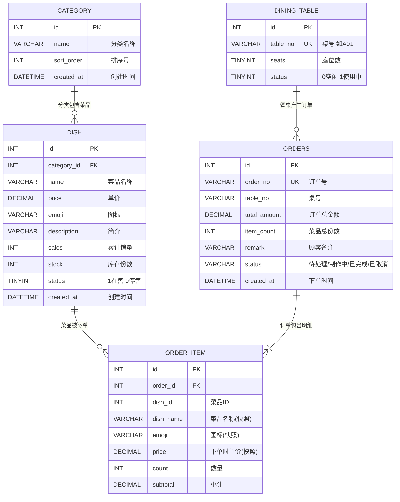

# 模拟餐厅点餐系统（课程作业 · 前后端分离）


```
2026-09-23-12-38-43/
├── restaurant-miniprogram/     微信小程序前端
│   ├── utils/api.js            后端接口封装（BASE_URL 指向 Java 后端 8080）
│   ├── pages/index/            点餐页（分类 + 菜品 + 购物车）
│   ├── pages/confirm/          订单确认页（选桌号 + 备注 + 提交）
│   ├── pages/orders/           历史订单页（列表 + 明细展开）
│   └── README.md
├── restaurant-java/            ★ Java 后端（课程使用的方案）
│   ├── pom.xml                 Maven 配置（Spring Boot 3.3.5 + MyBatis + MySQL）
│   ├── sql/schema.sql          MySQL 建表脚本（5 表 + 1 视图 + 索引 + 外键）
│   ├── sql/seed.sql            MySQL 初始数据
│   ├── src/main/java/...       分层代码：Controller / Service / Mapper / Entity / DTO
│   ├── src/main/resources/     application.yml + mapper/*.xml（SQL 映射）
│   └── README.md               启动方式、接口清单、技术要点
└── restaurant-server/          Node 后端（Express + SQLite，备用快速演示）
```

## 一、技术栈

| 层次 | 技术 |
| ---- | ---- |
| 前端 | 微信小程序原生开发（WXML / WXSS / JS），`wx.request` 调用 REST 接口 |
| 后端 | Java 21 + Spring Boot 3.3.5 + MyBatis 3 + Maven 3.9.9 |
| 数据库 | MySQL 8.4.3（InnoDB / utf8mb4 / 外键 / 索引 / 视图） |
| 通信 | HTTP + JSON，统一响应格式 `{ code, message, data }` |

## 二、环境（本机已配置完成）

| 组件 | 版本 | 位置 | 端口 |
| ---- | ---- | ---- | ---- |
| JDK | Zulu OpenJDK 21 | `C:\Program Files\Zulu\zulu-21` | - |
| Maven | 3.9.9 | `C:\Users\syxlw\maven\apache-maven-3.9.9` | - |
| MySQL | 8.4.3 | `C:\Users\syxlw\mysql\mysql-8.4.3-winx64` | **3307** |
| Java 后端 | Spring Boot | `restaurant-java` | 8080 |

> 说明：本机 3306 已被系统里既有的旧版 MySQL 5.5 服务占用，为避免冲突，本项目使用 3307。
> MySQL 账号：`root / 123456`，数据库 `restaurant`。

## 三、启动顺序（三步）

```bash
# ① 启动 MySQL（首次需先执行 sql/schema.sql 和 sql/seed.sql 建库导数据）
C:\Users\syxlw\mysql\mysql-8.4.3-winx64\bin\mysqld.exe --defaults-file="C:/Users/syxlw/mysql/my.ini" --console

# ② 启动 Java 后端
cd restaurant-java
mvn spring-boot:run            # 或 java -jar target/restaurant-java-1.0.0.jar

# ③ 微信开发者工具导入 restaurant-miniprogram，AppID 选"测试号"
```

验证：浏览器打开 <http://localhost:8080/api/health> 返回 `code: 0` 即正常。

## 四、数据库（5 张表 + 1 个视图）

| 表名 | 中文名 | 说明 |
| ---- | ------ | ---- |
| `category` | 菜品分类表 | 热菜 / 凉菜 / 主食 / 饮品 |
| `dish` | 菜品表 | 价格 DECIMAL(10,2)、销量、库存、上架状态 |
| `dining_table` | 餐桌表 | 桌号、座位数、占用状态 |
| `orders` | 订单主表 | 订单号、总额、备注、状态、下单时间 |
| `order_item` | 订单明细表 | 菜品名称/单价**快照**、数量、小计 |
| `v_order_detail` | 订单详情视图 | 主表与明细关联，便于报表查询 |

### E-R 图



### 实体间关系

| 关系 | 基数 | 关联字段 | 说明 |
| ---- | ---- | -------- | ---- |
| 分类 → 菜品 | 1 : N | `dish.category_id → category.id` | 外键约束，一个分类下有多道菜 |
| 订单 → 明细 | 1 : N | `order_item.order_id → orders.id` | 外键约束，**级联删除**（删订单自动删明细） |
| 菜品 → 明细 | 1 : N | `order_item.dish_id` | 逻辑关联（不建外键，避免菜品下架影响历史订单） |
| 餐桌 → 订单 | 1 : N | `orders.table_no` | 逻辑关联（按桌号匹配，便于餐桌状态流转） |

**外键**：`dish.category_id → category.id`、`order_item.order_id → orders.id`（级联删除）
**索引**：`idx_dish_category`、`idx_dish_status`、`idx_orders_created`、`idx_orders_status`、`idx_orders_table`、`idx_item_order`、`uk_table_no`、`uk_order_no`
**视图**：`v_order_detail`（订单主表 JOIN 明细，供统计报表直接查询）

> 设计要点：`order_item` 中的 `dish_name / price / emoji` 是**下单瞬间的数据快照**，
> 菜品后续改名或改价不会让历史订单金额失真。

## 五、作业提交与报告要点

**建议打包**：`restaurant-miniprogram` + `restaurant-java`（不含 `target`），Node 版可选。

**报告可写的技术点**：
1. 前后端分离架构与 REST 接口设计（12 个接口，统一响应结构）；
2. 数据库五表设计与 E-R 关系、外键约束、索引优化、视图应用；
3. **事务一致性**：`@Transactional` 保证订单主表 + 明细 + 库存销量三步原子提交；
4. **金额精度**：`BigDecimal` + `DECIMAL(10,2)`，避免浮点误差；
5. **快照设计**：订单明细保存菜品名称与单价，历史订单金额不受改价影响；
6. **订单状态机**：待处理 → 制作中 → 已完成 / 已取消，取消时回滚库存并重算餐桌状态；
7. **参数校验**：`@Valid` + 全局异常处理，业务错误统一返回友好提示；
8. **动态 SQL**：菜品查询支持分类过滤与模糊搜索的组合条件；
9. **前端降级策略**：接口不可用时自动切换本地数据，保证演示不中断。

**演示流程**：启动 MySQL → 启动 Java 服务 → 小程序点菜下单 → 订单页看到 MySQL 中的订单 → 浏览器/命令行调用 `/api/stats/summary` 展示统计数据。
